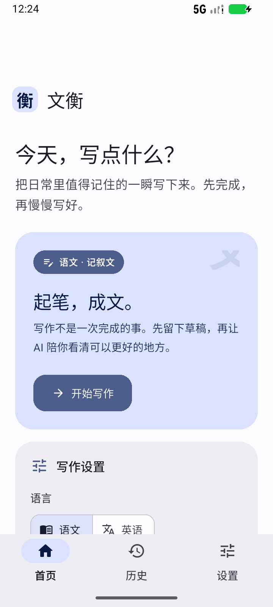
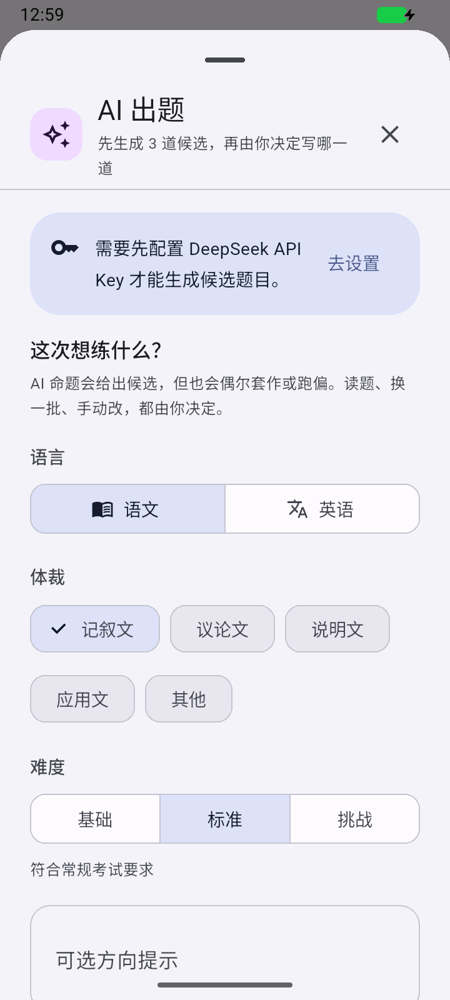
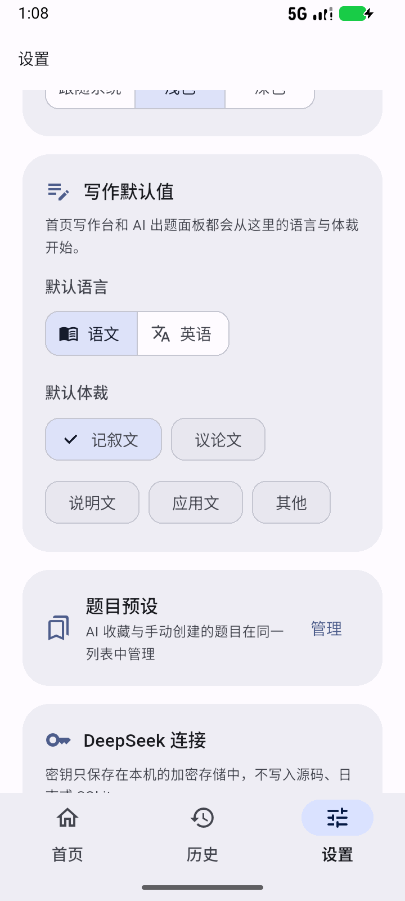

# 文衡 · essay_trainer

文衡是 Android 写作训练应用，Flutter 3.35 / Dart 3.9 实现。用户写中英文作文，提交后由 DeepSeek 返回总分、维度分、逐句诊断、逐段诊断和一版升格文。草稿、报告、题目预设都存在本机 SQLite。

没有后端，也没有账号。API Key 由用户自己填，应用直接请求 `api.deepseek.com`。这样不用部署服务端，也不用把 Key 交给代理；代价是没有账号、云同步和云端备份。只有测试连接、出题和批改会访问 DeepSeek。当前版本 `0.4.0+4`。

## 功能

- 语文、英语两种作文；体裁有记叙文、议论文、说明文、应用文、其他。
- 写作页实时统计字数。语文按汉字计数，英语按单词计数。字数目标是软目标：题目带建议字数时按题目的数字显示，否则回退到语文 300 字、英语 60 词；没写够也能提交，由批改指出。默认满分分别是 50 和 25。
- AI 出题一次返回 3 道候选，可换一批或收藏为预设。最近 10 批的标题会进入去重列表；连续两批标题或命题意图相似时，下一次请求追加换角度提示。
- 批改报告展示总分、维度分与理由、逐句反馈、逐段反馈、原文和升格版。逐句反馈分语法、用词、衔接、拼写、亮点五类，严重度分 critical、minor、suggestion、highlight。
- 报告可复制文本摘要，或调 Android 系统分享面板。分享走 `MethodChannel('essay_trainer/share')` 和 `ACTION_SEND`，没有引入 `share_plus`；原生通道不可用时回退到剪贴板。
- 历史页按时间倒序展示报告，左滑删除报告。
- 主题跟随系统，可覆盖为浅色或深色。有动态取色时用系统壁纸色，否则用种子色 `#3F5D50`。

## 下载安装

正式发行版在 [Releases](https://github.com/cloudw233/essay_trainer/releases)：arm64-v8a 的
签名 APK 加一份 `SHA256SUMS`。手机上打开 APK，允许“安装未知应用”后安装；覆盖安装
会保留草稿、报告和 Key。

下载后建议先校验：

```bash
sha256sum -c SHA256SUMS
apksigner verify --print-certs essay_trainer-0.4.0-arm64-v8a.apk
```

签名证书 SHA-256 应为
`bd30066f4f899289536cc73de68780a25a534447e646e6eac8686d9350072c1f`。发版流程见
[发布签名发行版](docs/releasing.md)。

## 环境

- Flutter 3.35.6 / Dart 3.9.2
- JDK 17
- Android SDK 36
- Android NDK 27.0.12077973
- 设备或模拟器 API 24 以上
- Linux 上运行 SQLite 测试需要 `libsqlite3`

Flutter 3.35 的 Android 构建会要求 NDK 27；CI 显式安装 `27.0.12077973`。`pubspec.yaml` 的 Dart SDK 约束是 `^3.9.2`。

主要依赖（`pubspec.lock` 当前解析版本）：`go_router 17.2.3`、`sqflite 2.4.2`、`flutter_secure_storage 10.3.4`、`dynamic_color 1.9.0`、`flutter_deepseek 0.1.1`、`http 1.6.0`。

## 快速开始

```bash
flutter pub get
flutter devices
flutter run -d <device-id>
```

构建调试 APK：

```bash
flutter build apk --debug
flutter build apk --debug --target-platform android-arm64
```

产物在 `build/app/outputs/flutter-apk/app-debug.apk`。

首次启动后：

1. 打开「设置 → DeepSeek 连接」。
2. 填入自己的 API Key，点「保存密钥」。
3. 点「测试连接」。请求内容是 `Say OK`，模型 `deepseek-chat`，`max_tokens=8`。

Key 写入 `flutter_secure_storage`，Android storage namespace 是 `essay_trainer_secure`。`AndroidManifest.xml` 设了 `allowBackup=false`。源码、SQLite 和日志里都不应该有 Key。

跑一篇作文：

1. 首页选语言和体裁，点「开始写作」；或点「AI 出题」，选一道候选。
2. 在写作页填标题和正文。字数进度对照题目要求的字数显示；没达到也可以提交批改。
3. 批改完成后进入报告页；报告也会写入历史。
4. 报告页可复制摘要或分享。

## 配置

没有配置文件，也没有代理后端。运行时可以改的只有 API Key、主题、默认语言和默认体裁。

| 数据 | 位置 |
| --- | --- |
| API Key | Android 安全存储，key `deepseek_api_key` |
| 主题、默认语言/体裁 | SQLite `app_settings` |
| 草稿、报告、预设 | SQLite `essay_trainer.db`，表 `drafts` / `reports` / `presets`，schema v2 |
| 批改端点 | `GradingService.baseUrl`，默认 `https://api.deepseek.com`；`main.dart` 用默认值，换代理要改代码 |

出题走 `flutter_deepseek` 的客户端，没有单独的端点配置项。

构建相关的几个固定值：

- `android/gradle/wrapper/gradle-wrapper.properties` 指向华为云 Gradle 8.12 镜像。网络能直连时改回 `https://services.gradle.org/distributions/gradle-8.12-all.zip`。CI 会在 workflow 里替换成官方地址。
- `dependency_overrides.path_provider_android` 固定在 `2.2.23`，避免 2.3.x 引入 JNI/CMake 构建。
- `android/build.gradle.kts` 给 `dynamic_color` 单独 apply Kotlin 插件。`dynamic_color 1.9.0` 假设 AGP 9 内建 Kotlin，当前 Flutter 3.35 / AGP 8.9 没有。

漏洞或 Key 泄露按 [SECURITY.md](SECURITY.md) 处理。

## 批改与出题请求

批改在 `lib/services/grading_service.dart`：

- `POST https://api.deepseek.com/chat/completions`
- `model: deepseek-chat`，`temperature: 0.3`，`max_tokens: 4096`，`stream: false`
- 用 `tools` 和 `tool_choice` 强制调用 `submit_grading_report`，schema 在 `lib/core/prompts/grading_tool.dart`
- 默认超时 120 秒；超时、401、429、400、503 都映射成中文错误
- 工具参数校验失败重试一次；第二次仍失败就抛错，并保留原始响应
- `flutter_deepseek 0.1.1` 的非流式响应会丢掉 `tool_calls`，所以批改自己用 `http` 发请求；只有连接测试和出题还用这个包

出题在 `lib/services/prompt_generation_service.dart`：

- `response_format: {"type": "json_object"}`，不用 `strict`，不用 function calling
- `temperature: 0.9`，`max_tokens: 1800`，默认超时 60 秒
- 客户端检查 `prompts` 正好 3 项、`promptText` 非空、`genre`/`difficulty` 合法、`suggestedWordCount` 为正整数；失败重试一次

评分规则：

- 语文 50 分：立意与内容 20、结构与层次 15、语言与表达 10、书写与规范 5。Prompt 写死这四个名称和满分（见 `lib/core/prompts/grading_prompts.dart` 的 `chineseGradingPrompt`）；客户端校验字段和总分上限，不校验四个维度之和。
- 英语 25 分：Content、Language、Structure 三维。Prompt 要求维度分之和等于总分，但不给每维固定满分；各维 `maxScore` 由模型返回，客户端同样只做结构校验。

## 目录

```text
lib/
  core/
    database/      建表；drafts / reports / presets / settings 仓库
    prompts/       中英文批改 prompt、submit_grading_report schema、出题 prompt、PromptBuilder
    theme/         Material You、语义色、主题控制器
    utils/         字数、ID、日期、报告摘要、文本相似度
  features/        home / editor / prompt_generation / presets / grading / report / history / settings / shell
  models/          EssayDraft、GradingReport、GeneratedPrompt、PromptPreset 等
  services/        DeepSeek 连接测试、批改 HTTP、出题、SecureStorage、系统分享
  main.dart        启动、数据库和控制器初始化
  router.dart      go_router 路由
tool/              live_grading_check / live_prompt_check / live_chinese_grading_check
test/              60 项测试
docs/              阶段报告与截图
```

路由入口在 `lib/router.dart`：底部三个主页面是 `/`、`/history`、`/settings`；`/editor`、`/grading`、`/report`、`/presets` 是推入路由。

主题颜色：`AppTheme.seedColor` 是唯一颜色字面量；其余颜色取自 `ColorScheme`，批改语义色集中在 `AppSemanticColors`。

## 界面

| 首页 | AI 出题参数 | 设置 |
| --- | --- | --- |
|  |  |  |

截图来自 Android 16（API 36.1）x86_64 模拟器的 release AOT 构建。其余截图在 `docs/screenshots/`；报告页和历史页的截图还没有。

## 开发与测试

```bash
dart format lib test tool
flutter analyze --no-pub
flutter test --no-pub
```

本地结果：`flutter test --no-pub` 60 项通过；`flutter analyze --no-pub` 无问题。测试覆盖 SQLite v1→v2 迁移、批改和出题的 JSON 校验与重试、401 映射、报告页、分享通道、历史页滑动删除、主题和设置页。

Linux 上 `sqflite_common_ffi` 使用宿主 SQLite。如果只有 `libsqlite3.so.0` 而没有 `libsqlite3.so`：

```bash
mkdir -p .tooling/native
ln -sf /lib64/libsqlite3.so.0 .tooling/native/libsqlite3.so
LD_LIBRARY_PATH="$PWD/.tooling/native" flutter test --no-pub
```

`/lib64/libsqlite3.so.0` 按发行版的实际路径调整。

真实 API 检查会产生 DeepSeek 费用：

```bash
DEEPSEEK_API_KEY=... flutter test tool/live_grading_check.dart
DEEPSEEK_API_KEY=... flutter test tool/live_prompt_check.dart
DEEPSEEK_API_KEY=... flutter test tool/live_chinese_grading_check.dart
```

脚本只从环境变量读 Key，不写入仓库、SQLite 或日志。CI 不运行这三项。

CI 在 `.github/workflows/ci.yml`：

- push 到 `main`/`master`、PR、手动触发
- `quality`：Flutter 3.35.6、JDK 17，安装 `libsqlite3-dev`，执行 `dart format --output=none --set-exit-if-changed lib test tool`、`flutter analyze --no-pub`、`flutter test --no-pub`
- `android-debug`：非 PR 时安装 NDK 27，把 Gradle 镜像换成官方地址，构建 `android-arm64` debug APK，上传 artifact，保留 7 天
- 不需要 DeepSeek Key

发布不在 Actions 里：正式版由 `tool/release.sh` 在本机用发布密钥签名、验签并调用本机
`gh` 创建 GitHub Release。`.github/workflows/nightly.yml` 只负责每天 03:00
（Asia/Shanghai）构建 debug 签名的 nightly APK 并上传 artifact，不接触发布密钥，也不
创建 Release。细节见 [发布签名发行版](docs/releasing.md)。

CI 已经在 GitHub 托管 runner 上跑过（`quality` 和 `android-debug` 都通过）。提交前检查见 [CONTRIBUTING.md](CONTRIBUTING.md)。

阶段报告和模块说明在 `docs/`：[第一阶段报告](docs/phase1-report.md)、[第二阶段报告](docs/phase2-report.md)、[第三阶段报告](docs/phase3-report.md)、[AI 命题模块](docs/ai_prompt_module.md)、[仓库自动化](docs/repo-automation.md)。

## 已知限制

- 只有 Android 工程，`minSdk 24`。没有 iOS、Web 或桌面目录。
- 没有后端、账号和云同步。卸载或清除应用数据会删掉草稿、报告和预设；Key 也要重新填。
- 批改依赖 DeepSeek。断网、401、429 或其他 HTTP 错误都会失败，应用只负责映射成中文提示。
- 批改请求会带上标题、正文、题目快照、语言/体裁和满分；没有本地模型或离线批改。
- 等待页是四个阶段文字、已等待时间和不定进度条，不是 token 流。批改请求固定 `stream: false`。
- 客户端只校验返回结构，不判断评分是否合理。语文四维之和、英语各维满分都没有被强制；通过校验后模型给什么就显示什么，只保证总分不超过满分、字段非空且类型正确。
- 英语各维 `maxScore` 由模型决定，不同报告之间可能不一致。
- 包名是 `uk.cloudw233.essay_trainer`；用旧包名 `com.example.essay_trainer` 安装的包会被 Android 视为另一个应用，不能覆盖升级。
- 应用内真实 Key 的完整点击链路没在稳定设备上复验：模拟器没有 `/dev/kvm`，软件模拟下 `system_server` 持续 ANR。服务层 live check 已通过；系统分享 chooser 也缺现场截图。
- 报告只能复制或分享文本摘要，不能导出 PDF、DOCX 或其他格式。

## License

MPL-2.0。完整文本见 [LICENSE](LICENSE)。这是文件级 copyleft：修改受 MPL 覆盖的文件后，这些文件需要按 MPL 2.0 发布；不要求整个项目采用同一许可证。此说明不构成法律意见。
