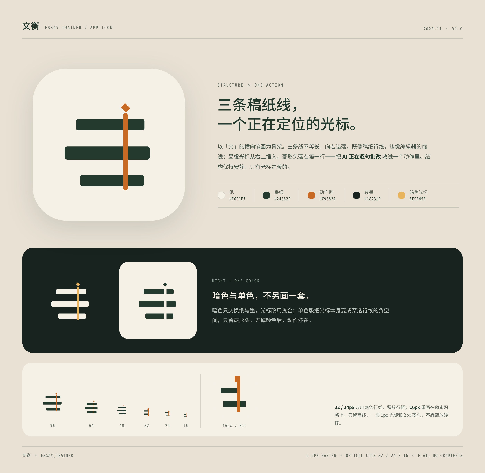

# 文衡 · App Icon

以「文」的横向笔画为骨架：三条不等长、向右错落的稿纸行线，被一根墨橙光标从右上插入。光标头是一枚小菱形，放大像审阅标记，缩小后收成一个点。



## 文件

| 文件 | 用途 |
| --- | --- |
| `icon.svg` | 主图标，512 网格，圆角纸面 |
| `icon-dark.svg` | 暗色版：深墨底、米纸线、浅金光标 |
| `icon-monochrome.svg` | 单色版；光标变成穿透行线的负空间，只留菱形头 |
| `icon-glyph.svg` | 透明底图形，用于应用内、开屏、文档 |
| `icon-foreground.svg` | Android adaptive icon 前景层，已按 66/108 安全圆缩放 |
| `icon-monochrome-foreground.svg` | Android 13+ 主题图标用的单色前景层 |
| `icon-compact.svg` | 32 / 24px 光学版本：两条行线，释放行距 |
| `icon-16.svg` | 16px 像素网格版本：两线、1px 光标、2px 菱头 |
| `png/` | 512、384、192、144、96、72、64、48、32、24、16 的 PNG，以及暗色、单色、前景层 |
| `preview.html` / `preview.png` | 设计说明与尺寸校验图 |
| `build.mjs` | 用 sharp 重新导出 PNG：`node assets/icon/build.mjs` |
| `install-android.mjs` | 把各密度图标、adaptive icon XML 和背景色写入 Android 资源：`node assets/icon/install-android.mjs` |

## 色板

| 角色 | 色值 |
| --- | --- |
| 纸 | `#F6F1E7` |
| 墨绿 / 结构 | `#243A2F` |
| 动作橙 / 光标 | `#C96A24` |
| 夜墨 | `#18231F` |
| 暗色光标 | `#E9B45E` |

结构色与动作色保持 1:1 的分配：三条线和纸面负责“写作”，只有光标是暖色。去掉颜色后，结构仍然完整；单色版用负空间保留光标的位置。

## 几何

- 512 × 512 画布，圆角 116。
- 行线高 38–44，间距约 92；三条线的长度分别为 230、286、214。
- 光标宽 16，纵向 150–410；菱形头 24 × 20，居中对齐在光标的 x 轴上。
- 16px 版本重画在 16 单位网格上，不缩放主图标。

## 接入 Android

已经写入 `android/app/src/main/res`，并替换了 Flutter 默认图标：

| Android 资源 | 内容 |
| --- | --- |
| `mipmap-*dpi/ic_launcher.png` | 48 / 72 / 96 / 144 / 192 的 legacy 图标 |
| `mipmap-*dpi/ic_launcher_foreground.png` | 108 / 162 / 216 / 324 / 432 的 adaptive 前景 |
| `mipmap-*dpi/ic_launcher_monochrome.png` | 同尺寸的 Android 13+ 单色层 |
| `mipmap-anydpi-v26/ic_launcher.xml` | API 26–32：background + foreground |
| `mipmap-anydpi-v33/ic_launcher.xml` | API 33+：额外声明 `<monochrome>` |
| `values/ic_launcher_background.xml` | 背景色 `#F6F1E7` |

`icon-foreground.svg` 和 `icon-monochrome-foreground.svg` 都按 66/108 安全圆缩到 0.84，圆形、squircle 和圆角方形遮罩都不会切到行线。单色层把光标做成透明槽，Android 的 themed icon 只负责给实心部分上色。

改了 SVG 后重新执行：

```bash
node assets/icon/build.mjs
node assets/icon/install-android.mjs
```

资源层已用 Android SDK 36.1 的 `aapt2 compile` / `aapt2 link` 验证，并用 `:app:assembleRelease -Ptarget-platform=android-arm64` 完整构建 APK 通过。`aapt2 dump resources` 能解析到 5 个密度的 legacy、foreground、monochrome，以及 `anydpi-v26` 和 `anydpi-v33` 两套 adaptive icon；APK 的 `application-icon` 指向 `anydpi-v33/ic_launcher.xml`。
