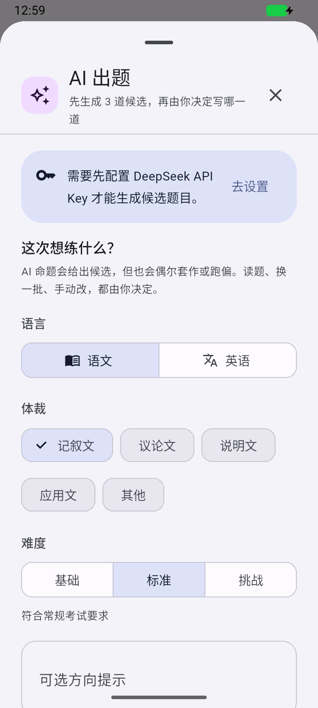
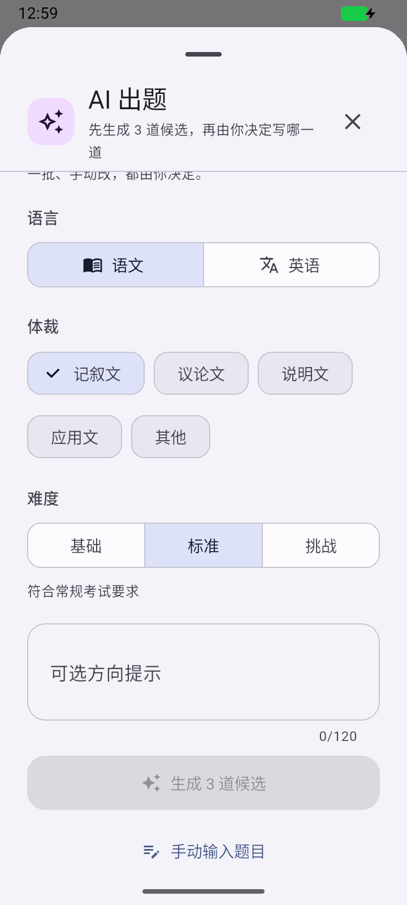
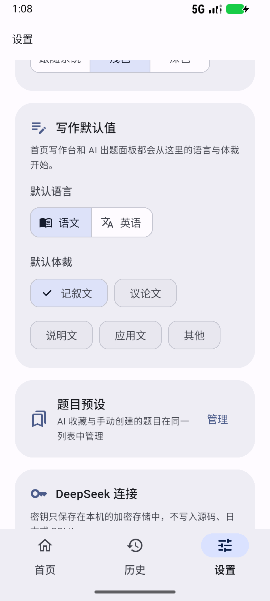
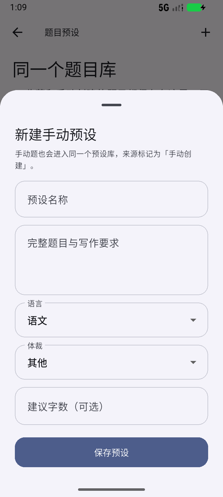

# AI 命题模块验收报告

日期：2026-11-22

## 1. 已实现

- 首页「开始写作」旁新增 `FilledButton.tonalIcon`「AI 出题」。
- 参数面板使用 `showModalBottomSheet`：语言、体裁、难度、可选方向提示。
- 一次请求生成 3 道候选；卡片展示标题/摘要、体裁、难度、建议字数与 rationale。
- 候选操作：`选这道`、`换一批`、`收藏`、`调整参数`、手动输入题目兜底。
- 只有点「选这道」才会创建草稿；AI 生成的题目不会自动替换当前作文题。
- 收藏写入 `PromptPreset.source = ai`，可在「设置 → 题目预设」与手动来源一起
  查看/删除。
- 选中题目时把 `promptText` 快照与可选 `promptPresetId` 写入 `EssayDraft`；
  写作页顶部显示只读题目区。
- 设置页新增默认语言/体裁；首页与 AI 出题面板共享 `WritingDefaultsController`。
- SQLite schema 从 v1 迁移到 v2，旧草稿和旧预设保持可读。

## 2. Prompt 设计

新文件 `lib/core/prompts/prompt_generation.dart`，与 `grading_prompts.dart` 完全
分离：

- 两套独立 system prompt（高考语文 / 高考英语）。
- 参数由 user message 传入：`language`、`genre`、`difficulty`、`count=3`、
  `avoid_titles`、`extra_hint`。
- 写死完整写作要求、三角度差异、陈词滥调禁用清单、难度约束与英语语篇类型。
- 完整 JSON 示例写进 system prompt，并声明 `json_object` 只保证合法 JSON，
  不保证字段结构。
- 明确要求只输出 JSON 对象，不带解释或 Markdown fence。

## 3. 调用与校验

`PromptGenerationService`：

- 使用 `response_format: {"type": "json_object"}`。
- 不使用 `strict`，不使用 function calling。
- 客户端校验：
  - `prompts` 数组长度必须为 3；
  - `promptText` 非空；
  - `difficulty` / `genre` 必须是枚举值；
  - `suggestedWordCount` 必须为正整数；
  - 三道题不能完全相同。
- 校验失败只重试一次，第二次 user message 追加：
  “上一次输出未通过格式校验，请只返回符合上述 schema 的 JSON，字段名和类型必须完全一致。”
- 连续失败抛出 `PromptGenerationException`，UI 显示错误并提供手动输入。

## 4. 去重与多样性

`PromptGenerationController`：

- 保留最近 10 批的标题与题目摘要，作为下一次请求的 `avoid_titles`。
- 用字符 bigram / 英文单词的 Jaccard 相似度比较相邻两批标题 + rationale。
- 连续两批高度相似时，下一次请求自动追加：
  “请完全避开前两批的命题方向，换一个全新的切入点。”
- 每次请求仍是无状态单轮请求，不累积修题对话。

## 5. 测试证据

```text
$ flutter test --no-pub
+55: All tests passed!   # AI 命题时为 46；第二阶段新增 9 项

$ flutter analyze
No issues found!
```

新增覆盖：

- 命题 system prompt 质量闸门、JSON 示例、参数在 user message 中出现。
- GeneratedPrompt 严格校验空 promptText / 非法枚举 / 非正词数。
- JSON 模式请求结构、无 `strict`/`tools`。
- 第一次 schema 校验失败 → 第二次成功，且带修正提示。
- 两次失败 → 抛出异常，不静默吞掉。
- 401 → 中文可操作错误。
- 相似度去重与第三批自动 hint。
- 最近 10 批 avoid 列表上限。
- 候选面板向 MockClient 生成 3 道候选、展示 3 个「选这道」、收藏写入 Preset。
- `EssayDraft.promptText`/`promptPresetId` 序列化。
- v1 → v2 SQLite 迁移。
- `PromptBuilder.userPrompt` 包含题目上下文。

## 6. 未完成 / 受阶段边界限制

1. **真实 DeepSeek 生成与连续两次“换一批”**：已用真实 Key 在
   `tool/live_prompt_check.dart` 中执行两批英语议论文生成。
   - 两批各 3 道，均为第一次通过；
   - 两批标题交集为 0，`lastBatchWasSimilar=false`；
   - 请求体、解析、重试、去重与候选 UI 另有 MockClient/widget test 覆盖。
2. **“提交批改后报告页正确关联题目与作文”**：第二阶段已补齐批改等待页、
   报告页与历史页；`EssayDraft.promptText` 会进入批改 user prompt，报告页
   也会从 `report.draftId` 读取并显示题目。该关联已由
   `test/features/grading_flow_test.dart` 和 `report_page_test.dart` 覆盖。
   真实 DeepSeek 成功批改已在服务层 live check 跑通；应用内点击复验仍受
   模拟器限制，详见 [第二阶段报告](phase2-report.md)。

## 7. 界面截图

| AI 出题入口 | 参数面板 |
| --- | --- |
|  |  |

参数面板向下滚动可看到方向提示、生成按钮与手动输入兜底：



设置页新增默认语言/体裁与题目预设入口：



题目预设库与手动新建表单：

| 预设库 | 新建手动预设 |
| --- | --- |
|  |  |

真实候选已通过服务层 live check 验证；截图仍只展示入口与参数面板，候选
卡片截图还需要稳定模拟器补拍。

## 8. 已知取舍

- 预设库已支持手动创建、AI 收藏、来源标签和删除；手动表单只覆盖题目与
  基本参数，不包含 rubric 编辑。
- 候选面板不显示完整长题目，卡片显示 4 行摘要；选中后写作页显示完整只读题目。
- 真实 AI 题目的内容质量只能在用户填入 key 后通过“换一批”人工判断。
