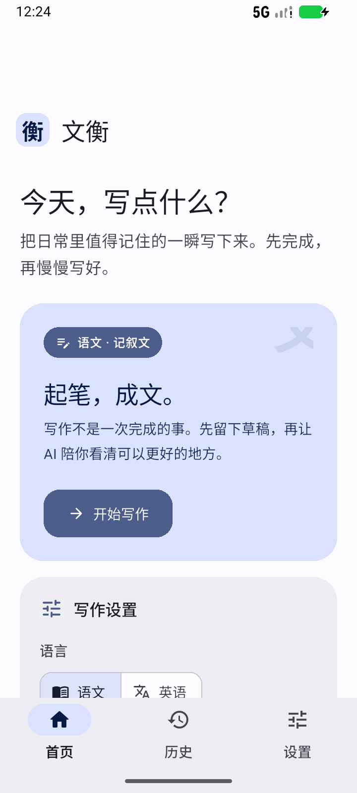
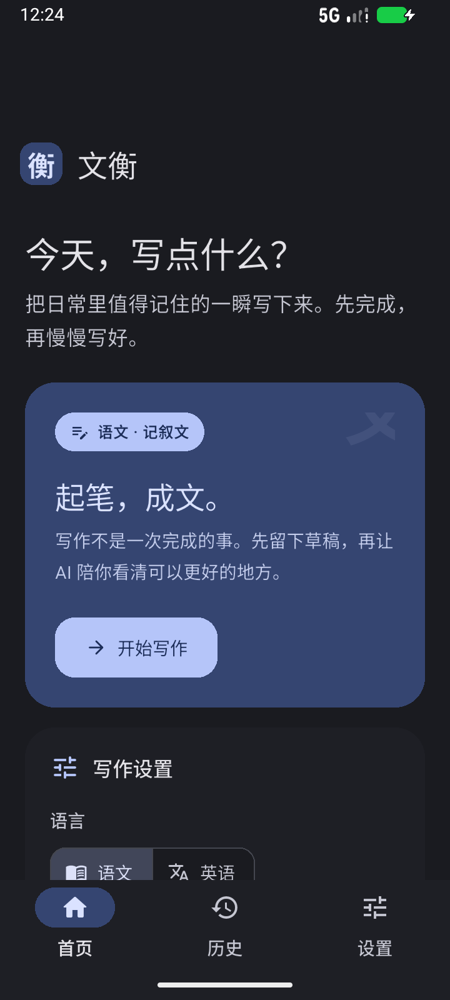
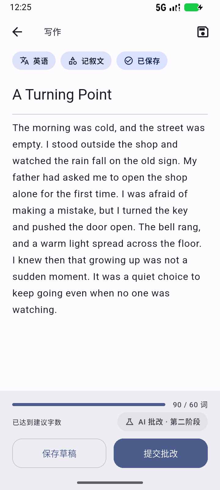
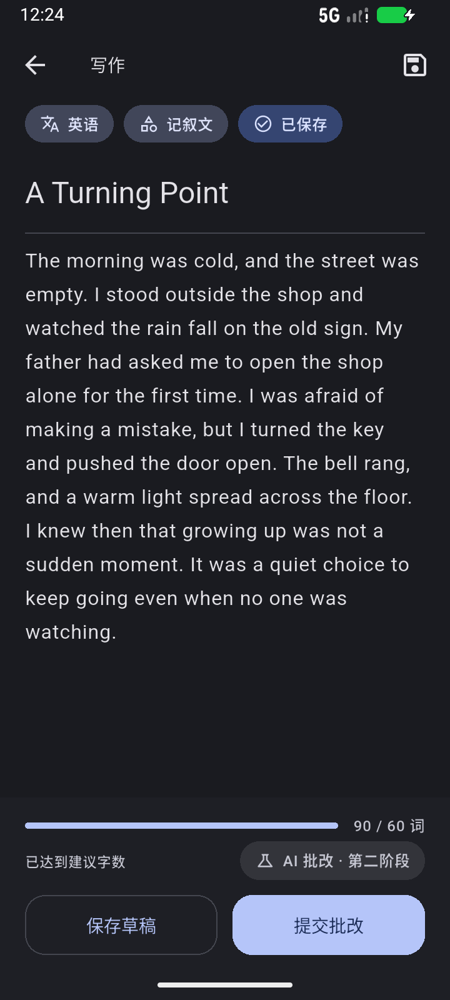
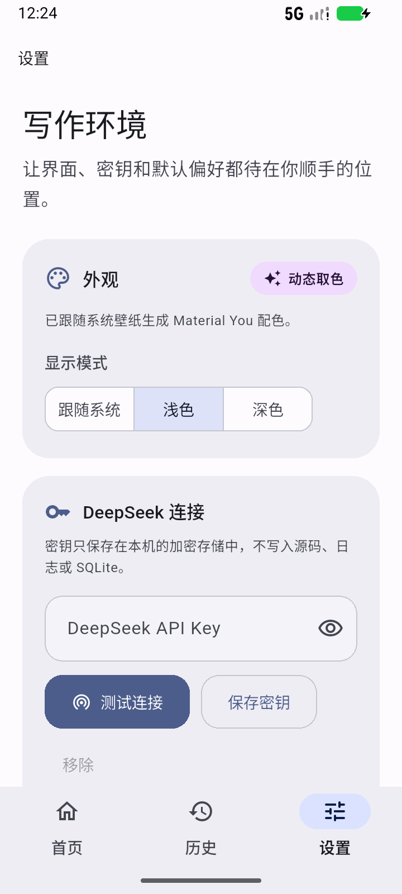
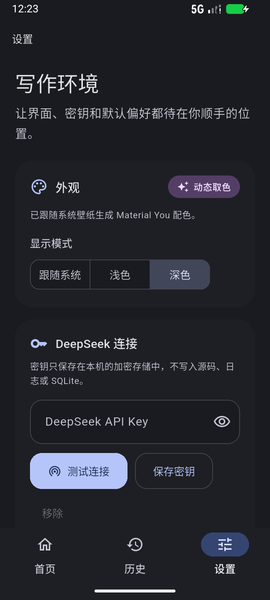
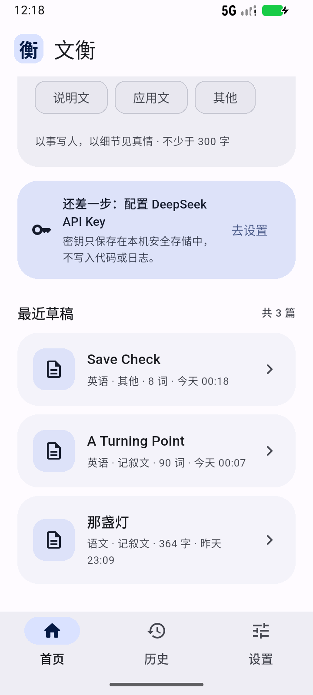
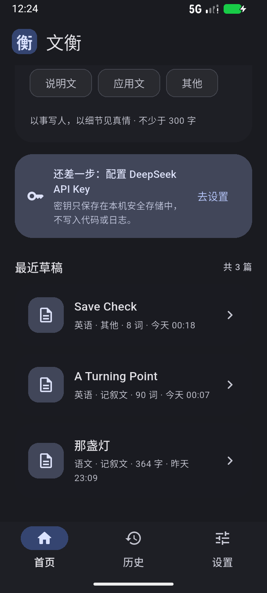

# 文衡 · 第一阶段验收报告

日期：2026-11-22  
设备：Android 16 / API 36.1 x86_64 模拟器（720 × 1600，320 dpi）  
构建：Flutter 3.35.6 / Dart 3.9.2 / JDK 17 / Android SDK 36 / NDK 27

## 1. 完成范围

- Flutter 项目 `essay_trainer`，包名 `com.example.essay_trainer`，仅 Android，
  `minSdk 24`。
- Material You 主题层：`DynamicColorBuilder`、动态取色、墨绿种子色回退、
  `AppSemanticColors extends ThemeExtension`、系统栏样式联动、深色/浅色/跟随
  系统三选一。
- 数据模型：`EssayDraft`、`GradingReport`、`DimensionScore`、
  `SentenceFeedback`、`ParagraphFeedback`、`PromptPreset`。
- SQLite：`drafts` / `reports` / `presets` / `app_settings`，含外键级联删除。
- API Key：`flutter_secure_storage` 保存与移除，Android Manifest 设置
  `allowBackup=false`。
- 页面：首页（Large/Medium 折叠式顶部栏、语言/体裁选择、最近草稿）、写作页
  （实时字数、最低字数进度、保存草稿、提交校验）、历史占位页、设置页
  （API Key 测试、主题模式、动态取色状态）。
- 语文 / 英语两套批改 system prompt 与 `PromptBuilder` 骨架，为第二阶段
  function calling 预留字段契约。
- 27 项自动化测试；`flutter analyze` 无告警。

## 2. 目录

```text
lib/
  core/
    database/      建表 + drafts / reports / presets / settings 仓库
    prompts/       语文、英语批改 system prompt；PromptBuilder
    theme/         AppTheme、AppSemanticColors、DynamicColorScope、
                   ThemeController、共用小组件
    utils/         字数统计、ID、时间显示
  features/
    home/          写作入口、最近草稿、API Key 引导
    editor/        写作页、实时字数、保存草稿
    history/       历史占位
    settings/      API Key、连接测试、主题模式
    shell/         底部 NavigationBar
  models/          不可变数据模型
  services/        DeepSeekService、SecureKeyStore
  essay_trainer_app.dart
  main.dart
  router.dart
test/              7 个测试文件，27 项测试
docs/screenshots/  验收截图
```

## 3. 构建与静态检查

```text
$ flutter analyze
Analyzing essay...
No issues found!
```

```text
$ flutter build apk --release --target-platform android-x64 --no-pub
✓ Built build/app/outputs/flutter-apk/app-release.apk (19.8MB)
```

截图使用 release AOT 构建。当前容器没有暴露 `/dev/kvm`，软件模拟下 debug JIT
首帧极慢，且会触发系统 ANR；release AOT 使用同一份业务代码，只是运行模式不同。

## 4. 自动化测试

```text
$ LD_LIBRARY_PATH="$PWD/.tooling/native" flutter test
...
00:02 +27: All tests passed!
```

覆盖：

- 英语词数、语文汉字数、最低字数单位。
- 草稿/报告/预设的 SQLite 行映射与 AI JSON 映射。
- 英语四步批改 prompt、语文四维 prompt、用户 prompt 中的标题/正文/评分标准。
- 主题使用 Material 3、`tonalSpot` 回退、正文 1.7 行高、页面转场。
- 语义色全部来自 `ColorScheme` 角色。
- SQLite 关闭后重新打开仍能读到草稿、报告嵌套结构、级联删除、设置读写。
- DeepSeek `Say OK` 请求结构、401/429 错误映射。
- 主题模式持久化、设置页 `SegmentedButton` 切换、API Key 控制器生命周期。

## 5. 截图

| 浅色 | 深色 |
| --- | --- |
|  |  |
|  |  |
|  |  |

最近草稿：

| 浅色 | 深色 |
| --- | --- |
|  |  |

## 6. 动态取色

模拟器为 Android 16（API 36.1）。`DynamicColorBuilder` 返回了系统壁纸
`CorePalette`，设置页显示「动态取色」，实际配色为壁纸派生的淡紫/深蓝，而
不是种子色墨绿。因此动态取色在本环境生效。

回退分支由 `AppTheme.fallbackScheme(Brightness)` 实现，单元测试验证了浅色/
深色、`DynamicSchemeVariant.tonalSpot`、语义色与 1.7 行高。未在 Android 11
设备上做运行时截图。

状态栏图标与系统导航栏在浅色截图中为深色、在深色截图中为浅色，由
`AppTheme.systemUiOverlayStyle` 与 `AnnotatedRegion` 跟随主题。

## 7. 持久化验证

1. 通过 debug 安装向 `/data/data/.../databases/essay_trainer.db` 写入三篇演示
   草稿（仅用于截图与手动验收）：`A Turning Point`（英语，90 词）、`那盏灯`
   （语文，364 字）、`Save Check`（英语，8 词）。
2. 安装 release 后，首页正确读取三篇草稿。
3. 打开 `Save Check`，把标题改为 `Save CheckZ`，点击保存。
4. 强制停止应用并重新启动；最近草稿中仍显示 `Save CheckZ`。
5. 再将标题恢复为 `Save Check` 并保存，说明修改写回同样正常。

SQLite 自动化测试另外覆盖了「关闭数据库 → 重新打开 → 草稿仍存在」以及报告
级联删除。

## 8. API 连接

- 设置页输入临时占位 key，点击「保存密钥」后显示「已保存」，说明
  `flutter_secure_storage` 读写成功。
- 点击「测试连接」，真实请求 `https://api.deepseek.com/chat/completions`，
  服务端返回 401；应用显示「连接失败 · API Key 无效或已过期，请检查后重试。」。
  这证明网络链路、请求体、错误映射和错误态 UI 都已跑通。
- 测试结束后已点击「移除」清空安全存储，仓库与设备中都没有留下真实 key。
- **真实 key 的 200 成功连接尚未验证**：交付中没有可用 key。需要你在设置页
  填入自己的 DeepSeek key 后点一次「测试连接」。占位 key 的错误态截图见
  [api_key_401.png](screenshots/api_key_401.png)。

## 9. 大字号检查

系统字体放大到 1.3x 后检查：

- 首页：语言/体裁、开始写作按钮、最近草稿卡片均无溢出，长元数据自动换行。
- 写作页：标题、正文、底部字数/按钮区域无溢出。
- 设置页：「跟随系统」标签换成两行，但控件与页面均未裁切；主题切换可点。
- 已恢复系统字体为 1.0。

## 10. 取舍与已知限制

- **动态色包构建兼容**：`dynamic_color 1.9.0` 的 Android 构建脚本假定 AGP 9
  的内建 Kotlin，在当前 Flutter 3.35 / AGP 8.9 下缺少 Kotlin 插件。已在
  `android/build.gradle.kts` 中仅对该子项目显式 apply Kotlin Android 插件，
  并加注释说明。
- **主题切换点击**：给设置页 `SegmentedButton` 加 `expandedInsets` 后，真机上
  点击不响应。已移除该参数，保留原生自适应的分段按钮，并新增设置页切换测试。
- **依赖固定**：`path_provider_android` 固定为 2.2.23，避免 2.3.x 引入 JNI /
  CMake 原生构建；Android 侧不直接使用 `path_provider`。
- **Gradle 镜像**：受限网络环境下 wrapper 指向华为云镜像；正常网络可改回
  `services.gradle.org`。
- 历史页目前为空态；报告页、历史详情、AI 批改、流式进度、分享/导出属于
  第二阶段及以后。
- 无后端服务器。API Key 采取 BYOK 直连 DeepSeek。

## 11. 第二阶段计划

1. 英语批改：`submit_grading_report` function calling、JSON 解析、失败重试一次。
2. 流式等待页（题干拆解 → 逐句分析 → 逐段诊断 → 评分）。
3. 报告页：维度进度、`AppSemanticColors` 逐句反馈、逐段建议、全文改写对比。
4. 历史记录读取 `GradingReport` 与滑动删除。
5. 端到端跑一篇英语作文，并在深色模式验收。

## 12. 验收清单

- [x] 项目可构建、可安装、可运行到 Android 模拟器。
- [x] 浅色/深色截图，动态取色在 Android 12+ 模拟器生效。
- [x] `Color(0x` 仅剩种子色；无 `Colors.`、无 `fontSize:`。
- [x] 草稿写 SQLite 后重启应用仍存在。
- [x] 设置页可保存/移除 API Key。
- [x] 真实 DeepSeek 端点可达，401 错误可见。
- [ ] 真实 Key 的 200 成功连接：等待用户提供 key 后手动验证。
