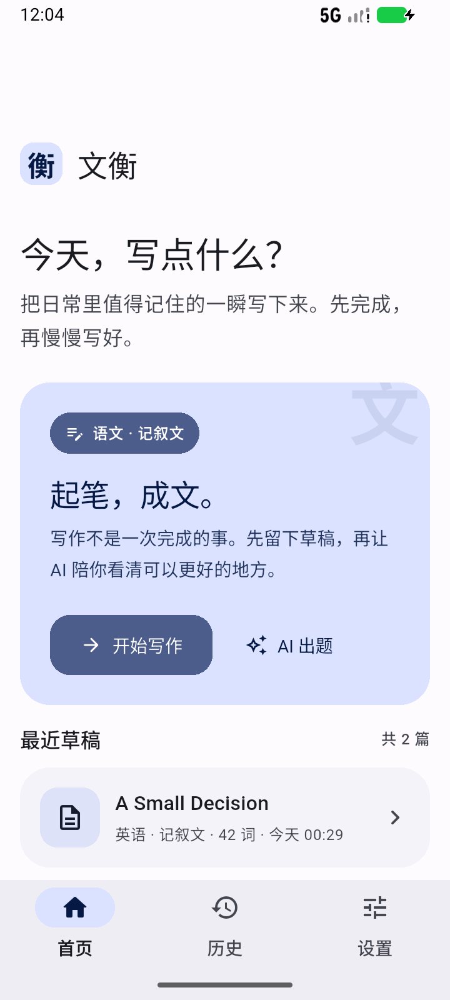
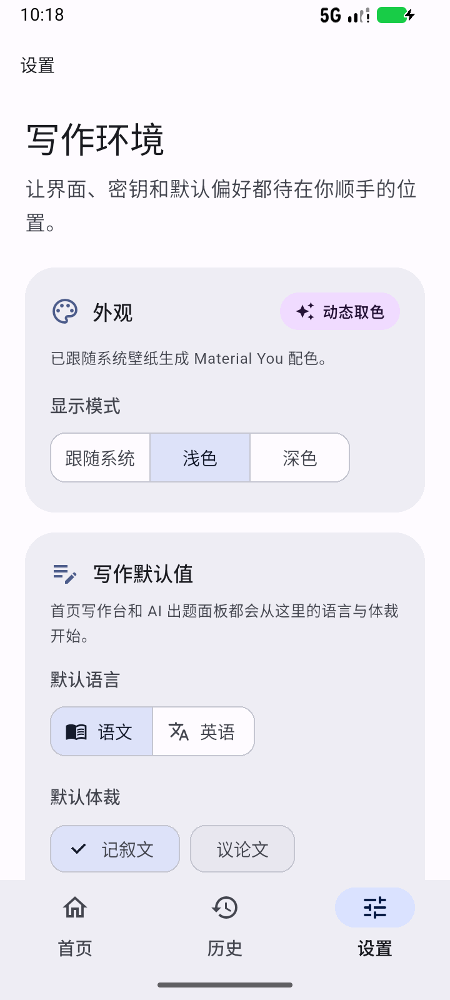
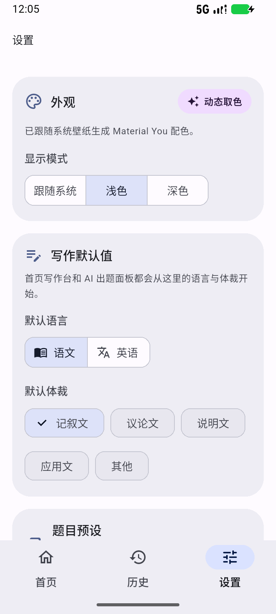
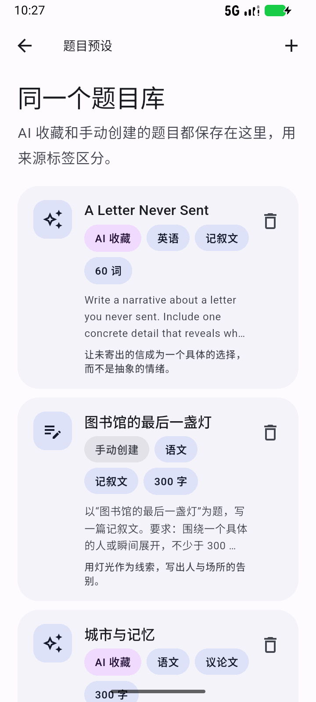
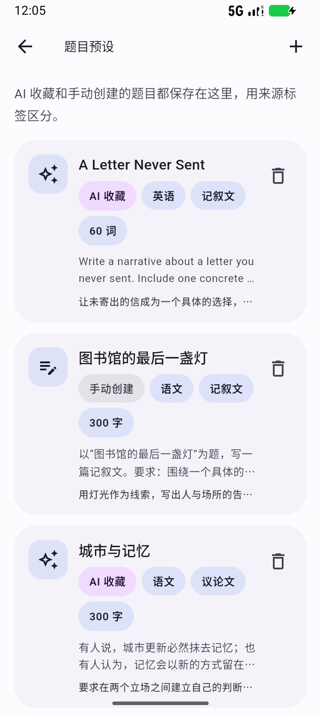
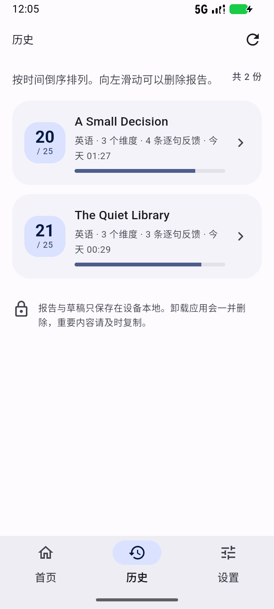
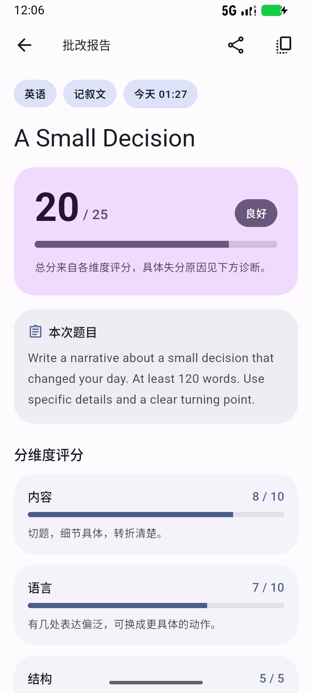
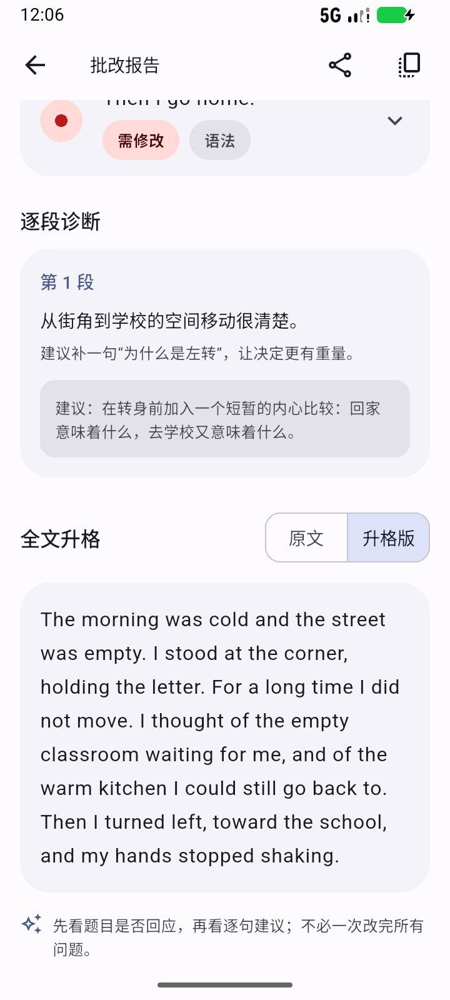
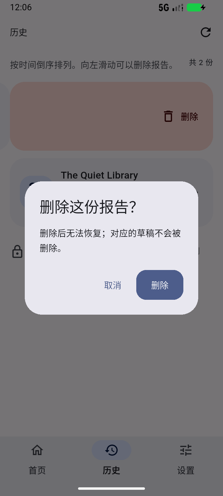
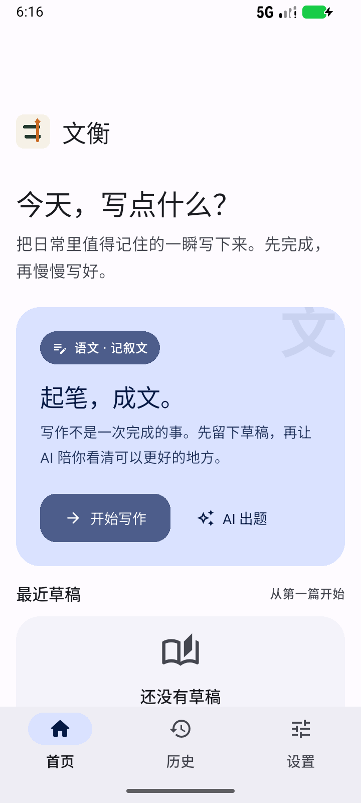

# 文衡 · P1 剩余项 + P2 收尾报告

日期：2026-11-22  
范围：P1-4、P1-7、P2-1 至 P2-7。  
环境：Android 16（API 36.1）模拟器，720×1600 px @ 320 dpi（360×800 dp）；release x64 AOT。  
主题层、`AppSemanticColors`、路由、数据库、AI 调用逻辑均未改。

## 完成清单

| ID | 项目 | 状态 |
|---|---|---|
| P1-4 | 历史/首页/预设空状态增加操作入口 | 完成 |
| P1-7 | 批改错误/缺 Key 的主操作移到底部固定区 | 完成 |
| P2-1 | 页面 16dp、间距网格、`AppSurface` 默认 16 | 完成 |
| P2-2 | 去掉设置/历史/预设的重复大标题 | 完成 |
| P2-3 | 报告逐句/逐段反馈统一为 `Card` | 完成 |
| P2-4 | 加载态改为固定高度 `AppLoadingState` | 完成 |
| P2-5 | 历史/预设统一为“滑动 + 确认 + 下拉刷新” | 完成 |
| P2-6 | 报告分享/复制图标间加 8dp | 完成 |
| P2-7 | 预设卡题目 2 行、理由 1 行、内边距 16 | 完成 |

---

## P1-4 空状态操作入口

- 首页：`_EmptyDrafts` 新增“写下第一篇”，复用 `_startWriting`。`lib/features/home/home_page.dart:637-646`
- 历史：空状态新增“去首页开始写作”，`context.go('/')`。`lib/features/history/history_page.dart:220-230`
- 预设：空状态新增“新建预设”，复用 `_createManual`。`lib/features/presets/preset_library_page.dart:214-223`
- 测试：
  - `home_layout_test.dart` 空草稿断言 CTA；
  - `history_page_test.dart` 空历史断言 CTA；
  - 新增 `preset_library_page_test.dart` 空预设断言 CTA。

本轮没有再次清空设备数据去拍空态截图；三个入口由上述 widget test 覆盖。

## P1-7 批改恢复操作固定在底部

- 位置：`lib/features/grading/grading_page.dart:188-217`。
- 缺 Key 时底部显示“去设置 API Key”，其他错误显示“重新批改”；错误内容仍可在 `ListView` 中滚动，原始响应和“返回编辑”保留。
- 测试：`grading_flow_test.dart` 新增“no key puts the recovery action in the bottom bar”，断言 `ValueKey('grading-bottom-actions')` 及其中的主按钮。

未取得运行截图：本机没有 DeepSeek Key，无法进入真实批改错误页；该行为由 widget test 覆盖。

## P2-1 间距与 16dp 网格

- `AppSurface` 默认 padding 20 → 16；`StatusPill` 垂直 padding 7 → 8。`lib/core/theme/app_widgets.dart:8`、`:121`
- 页面内容区统一 16dp：首页、编辑页、历史、报告、设置、预设。
- 垂直间距收敛到 {4,8,12,16,24}；列表卡内边距统一 16，列表项间距 12。
- 例外：底部弹出面板保留 24dp 外边距，作为 modal 的独立层级。

| 首页 P2 前（20dp） | 首页 P2 后（16dp） |
|---|---|
|  |  |

## P2-2 去掉重复大标题

- 设置：移除“写作环境”大标题与说明，保留 AppBar“设置”。
- 历史：移除“批改档案”大标题，保留一行说明 + 报告数。
- 预设：移除“同一个题目库”大标题，保留一行说明。
- 首页保留编辑式大标题，不与 AppBar 品牌重复。

| 设置 P2 前 | 设置 P2 后 |
|---|---|
|  |  |

| 预设 P2 前 | 预设 P2 后 |
|---|---|
|  |  |

历史页改后：

## P2-3 报告反馈容器一致

- 逐段反馈从 `AppSurface` 改为 `Card` + 16dp padding，与逐句反馈的 `Card` 骨架一致。`lib/features/report/report_page.dart:560-604`
- 报告内容区 16dp；分数卡 padding 24；题目卡/维度卡 padding 16；卡片间距统一 8/12。

| 报告顶部 | 报告逐段/全文 |
|---|---|
|  |  |

## P2-4 加载态固定高度

- 新增 `AppLoadingState`（`app_widgets.dart:69`），固定高度 + 居中进度。
- 使用位置：
  - 首页最近草稿：120dp；
  - 历史/报告/预设：240dp；
  - 批改：320dp。
- 状态切换时不会因为 spinner 高度变化导致整页跳动。

## P2-5 列表删除与刷新一致

- 历史：左滑后先弹“删除这份报告？”确认，确认后再删除；`RefreshIndicator` + `AlwaysScrollableScrollPhysics` 支持下拉刷新。
- 预设：同样支持左滑删除 + 确认，同时保留常驻删除图标；列表也支持下拉刷新。
- 删除失败时预设列表会重新 `_load()`，避免 UI 与本地库不一致。

| 历史删除确认 |
|---|
|  |

## P2-6 报告 AppBar 图标间距

- 分享/复制两个 `IconButton` 之间加 8dp，尾部也改为 8dp。`lib/features/report/report_page.dart:121-133`

## P2-7 预设卡密度

- 题目预览 3 → 2 行，理由 2 → 1 行。
- 卡片内边距 18/16/8/16 → 16/16/8/16；标签间距 6 → 8。
- 修改后单卡高度下降，首屏能同时看到约 2.5 条预设。

---

## 后续：主页左上角换成应用图标

- 旧：`InkSeal(size: 34, character: '衡')`。
- 新：`AppMark(size: 34)`，按项目 `assets/icon/icon-compact.svg` 的 32-unit 小尺寸切法绘制。
- 位置：`lib/core/theme/app_widgets.dart`（`AppMark` / `_AppMarkPainter`）、`lib/features/home/home_page.dart:169`。
- 说明：当前模拟器的 release 构建里 `Image.asset` 不合成位图（用红色块验证过布局本身正常），因此没有直接加载 PNG，而是用项目图标的 compact 几何重建为矢量；颜色使用图标原色（纸 `#F6F1E7`、墨绿 `#243A2F`、动作橙 `#C96A24`），34dp 下保持清晰。
- 测试：`home_layout_test.dart` 断言不再出现 `InkSeal`，且 AppBar 使用 `AppMark`。

---

## 文件 diff 摘要

- `lib/core/theme/app_widgets.dart`
  - `AppSurface` 默认 padding 16；`StatusPill` 垂直 padding 8；新增 `AppLoadingState`；新增 `AppMark` 矢量应用标记。
- `lib/features/home/home_page.dart`
  - 内容区 16；列表卡 padding 16、间距 12；空草稿 CTA；加载占位；左上角 `InkSeal` 换成 `AppMark`。
- `lib/features/history/history_page.dart`
  - 去大标题；16dp；删除确认；下拉刷新；空态 CTA；加载占位；卡片 padding 16、间距 12。
- `lib/features/presets/preset_library_page.dart`
  - 去大标题；16dp；下拉刷新；左滑删除 + 确认；空态 CTA；加载占位；卡片密度压缩。
- `lib/features/report/report_page.dart`
  - 16dp；分数卡 24、其他卡 16；逐段反馈改 `Card`；AppBar 图标 8dp；加载占位；间距归一。
- `lib/features/settings/settings_page.dart`
  - 去“写作环境”大标题；16dp；间距落在 4/8/12/16/24。
- `lib/features/editor/editor_page.dart`
  - 内容区/底部栏 16dp；提示卡 padding 12；间距归一。
- `lib/features/grading/grading_page.dart`
  - 错误主操作移到底部固定区；16dp；加载占位。
- `lib/features/prompt_generation/prompt_generation_sheet.dart`
  - 间距归一（modal 外边距仍 24）。

测试：

- `test/features/home_layout_test.dart`：新增空草稿 CTA。
- `test/features/history_page_test.dart`：删除确认 + 空历史 CTA。
- `test/features/preset_library_page_test.dart`：新增空预设 CTA。
- `test/features/grading_flow_test.dart`：新增缺 Key 底部操作断言。

---

## 验证

- `flutter test --no-pub` → **79 项全部通过**。
- `flutter analyze` → **No issues found**。
- `flutter build apk --release --target-platform android-x64 --no-pub` → 构建成功。
- 安装到 API 36.1 模拟器，按 720×1600 @ 320 dpi 采集了首页、历史、设置、预设、报告、删除确认截图。

## 已知限制

- P1-7 的真实批改错误页需要 API Key，未采集运行截图；由 widget test 覆盖底部操作位置。
- P1-4 的空状态未再次清空设备数据拍运行截图；由 widget test 覆盖三个入口。
- P2-5 历史仍以左滑为主、预设同时有左滑和图标；手势/确认/刷新已统一，但图标可见性仍有差异。
- P2-4 采用固定高度 spinner，不是逐页骨架屏；满足“切换不跳动”，但不是完整 skeleton。
- P2-1 的 modal 面板仍保留 24dp 外边距，这是 modal 的独立层级例外。
