# 文衡 · UI 布局优化（批次 A + B）

日期：2026-11-22  
范围：仅布局结构、间距、层级与操作位置；未改主题层、颜色体系、路由、数据库、AI 调用逻辑。  
设备：Android 16（API 36.1）模拟器，720×1600 px @ 320 dpi（360×800 dp）。  
构建：当前源码的 release x64 AOT APK。

## 本轮完成

| ID | 项目 | 状态 |
|---|---|---|
| P0-1 | 编辑页底部操作条键盘适配（IME 打开时改为紧凑操作栏） | 完成 |
| P0-2 | 出题面板键盘适配 + 顶部内容随 `viewInsets` 收缩 | 完成 |
| P1-2 | 出题面板“生成 3 道候选”移到固定 footer | 完成 |
| P1-1 | 首页顺序改为 Hero → 最近草稿 → API Key 提示 → 写作设置；AI 出题降为文字入口 | 完成 |
| P1-3 | 编辑页作文题预览高度 132 → 72dp（保守方案，不新增展开交互） | 完成 |
| P1-5 | 编辑页“AI 批改”从胶囊改为纯文本状态 | 完成 |
| P1-6 | 设置页“保存密钥”改为主按钮，“测试连接”改为次要按钮 | 完成 |
| 后续 | 首页 Hero 右上角“文”保持原位置，改为沿卡片圆角裁切 | 完成 |

未做（按约定保留）：P1-4 空状态 CTA、P1-7 批改错误重试底部固定、全部 P2 项。

---

## 1. 编辑页

### P0-1 键盘打开时，保存/提交不再被 IME 覆盖

- 违反原则：L3、L7。
- 改动：`Scaffold.bottomNavigationBar` 外包 `AnimatedPadding(bottom: viewInsets.bottom)`；IME 打开时 `_EditorBottomBar` 切换为紧凑栏，保留字数、保存与“提交批改”，标题栏的保存按钮仍可点。
- 位置：`lib/features/editor/editor_page.dart:277-306`、`:508-538`。

| 改前（1.0× + 键盘）：整条操作区消失 | 改后（1.0× + 键盘）：紧凑栏贴在键盘上方 |
|---|---|
| 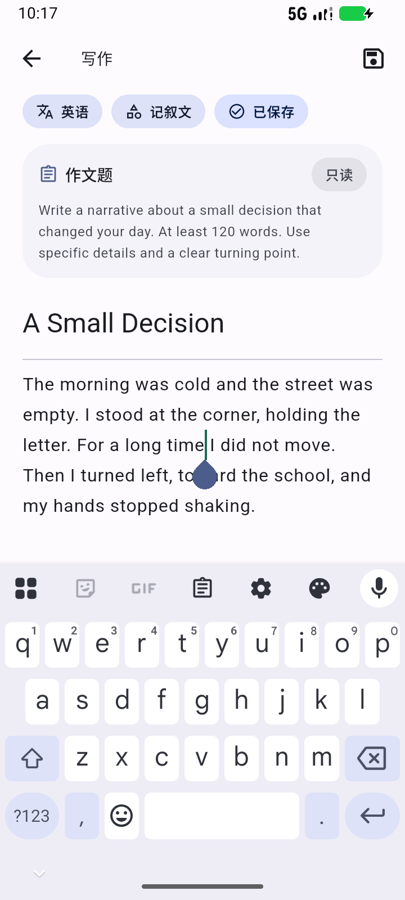 | 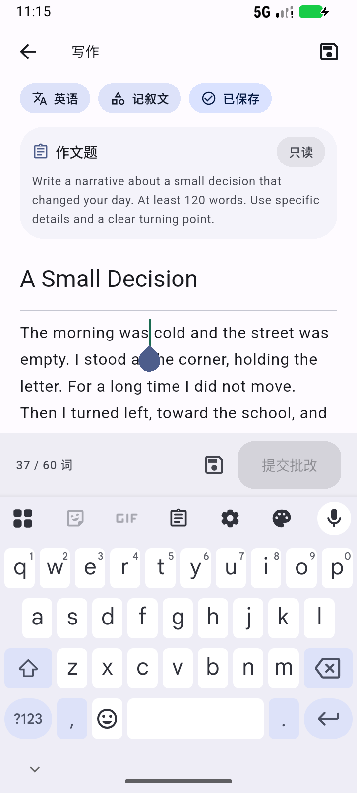 |

### P1-3 作文题卡压缩

- 违反原则：L3、L4、L7。
- 改动：`AppSurface` 内边距 14/12 → 12/10，标题与正文间距 8 → 6，预览 `maxHeight` 132 → 72。题目仍可在卡内滚动阅读，没有新增展开交互。
- 位置：`lib/features/editor/editor_page.dart:439-462`。

| 改前（1.0×）：题卡约占 180px | 改后（1.0×）：题卡约占 120px |
|---|---|
| 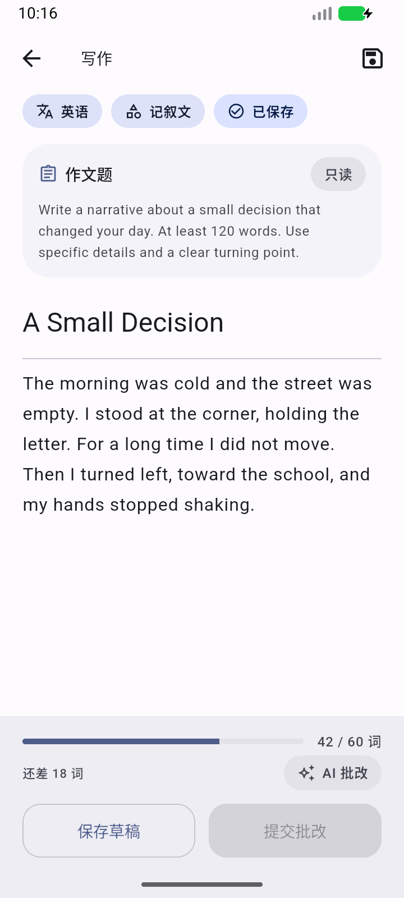 | 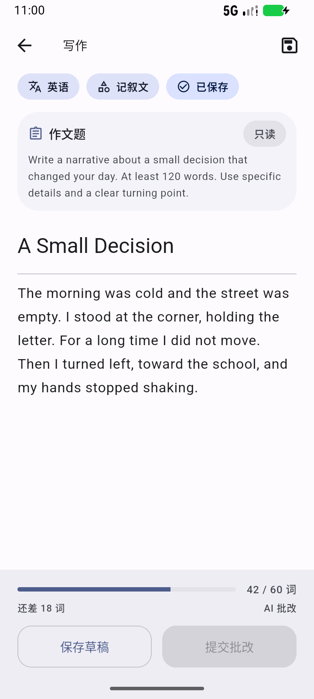 |

### P1-5 “AI 批改”不再像按钮

- 违反原则：L4、L6。
- 改动：状态行中的 `StatusPill` 改为 `Text`，不再有底色、图标和可点击错觉；真正的操作仍是“提交批改”。
- 位置：`lib/features/editor/editor_page.dart:576-584`。

### 1.3× 检查

| 改前（1.3×） | 改后（1.3×） |
|---|---|
| 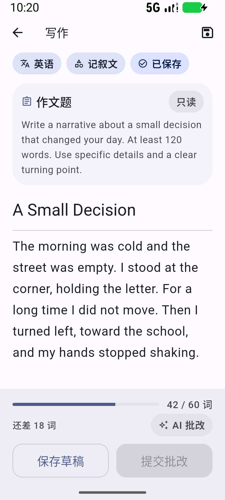 | 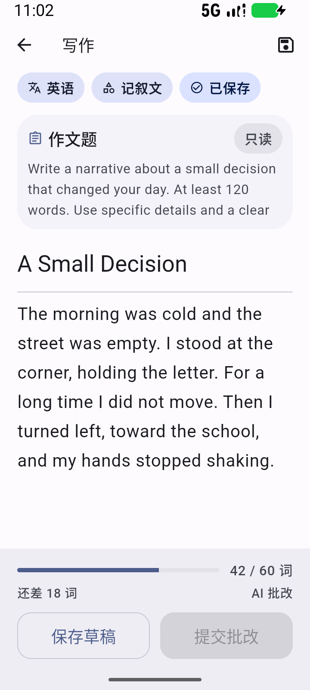 |

1.3× 下正文、标题、按钮均未截断；作文题卡到 72dp 后正文区明显变大。

---

## 2. 出题面板

### P0-2 + P1-2 键盘、输入框、生成按钮

- 违反原则：L3、L4。
- 改动：
  - `PromptGenerationSheet.build` 外包 `AnimatedPadding(bottom: viewInsets.bottom)`，整个面板内容随键盘上移。
  - 设置阶段拆成“可滚动表单 + 固定 footer”；footer 内含“可选方向提示”与“生成 3 道候选”。键盘打开时输入框和主按钮始终可见。
  - 删除设置/错误阶段里重复的 `viewInsets` 底部 padding。
- 位置：`lib/features/prompt_generation/prompt_generation_sheet.dart:207-214`、`:266-410`、`:598-649`。

| 改前（键盘打开）：输入框和生成按钮被盖住 | 改后（键盘打开）：footer 贴在键盘上方 |
|---|---|
| 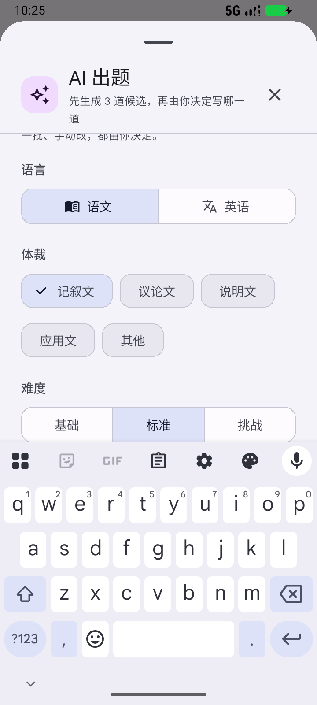 | 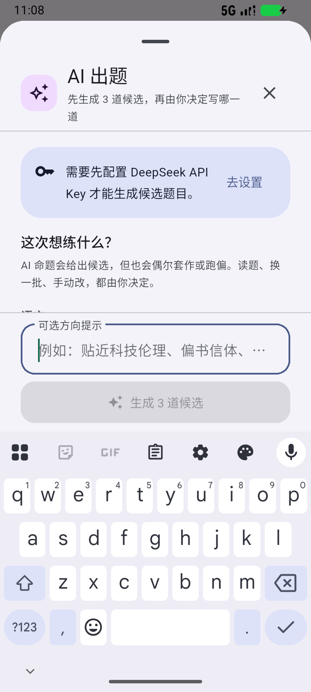 |

| 改前（首屏）：生成按钮在表单底部不可见 | 改后：生成按钮在固定 footer |
|---|---|
| 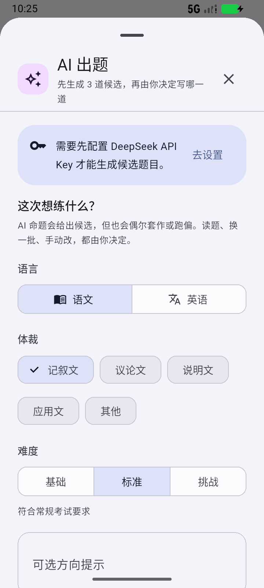 | 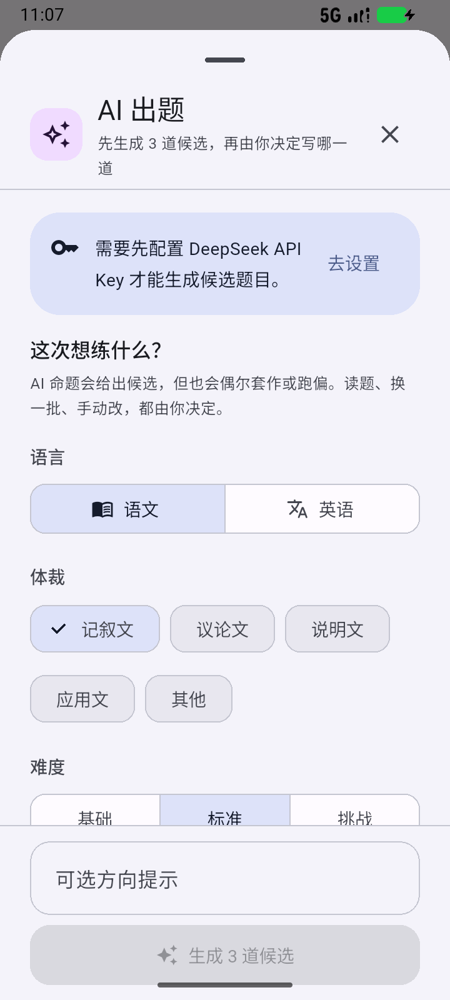 |

---

## 3. 首页

- 违反原则：L3、L4。
- 改动：
  - 顺序改为 Hero → 最近草稿 → API Key 提示 → 写作设置。
  - Hero 里只保留一个 filled primary“开始写作”；“AI 出题”从 `FilledButton.tonalIcon` 降为 `TextButton.icon`。
  - 写作设置卡仍然保留原控件，只下移并压缩内边距（20 → 16，部分 20 → 16 / 16 → 12）。
  - API Key 提示内边距改为 `16,12,8,12`，减少高度。
- 位置：`lib/features/home/home_page.dart:216-248`、`:370-382`、`:414`、`:502`。

| 改前（首屏）：两个入口抢视线，最近草稿在第二屏 | 改后（首屏）：单一主操作，最近草稿进入首屏 |
|---|---|
| 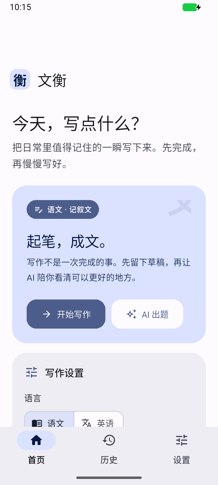 |  |

| 改前（下滑）：最近草稿在写作设置之后 | 改后（下滑）：最近草稿先出现，设置在后 |
|---|---|
| 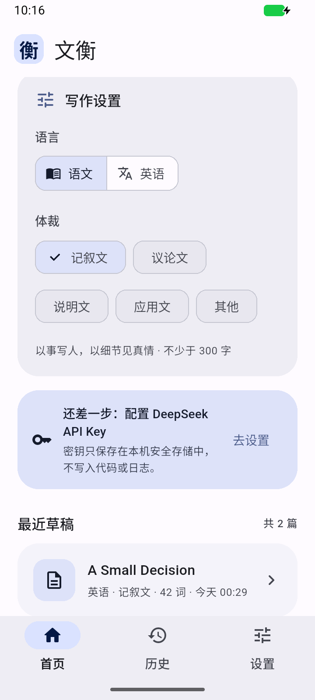 | 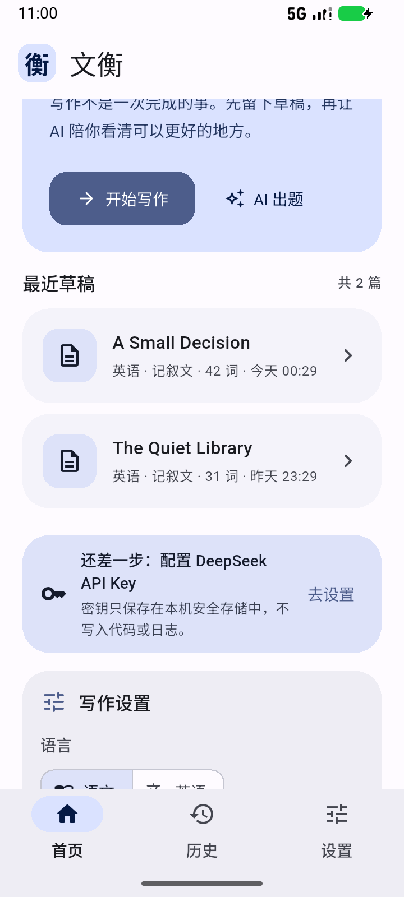 |

### 深色与 1.3×

| 深色改前 | 深色改后 |
|---|---|
| 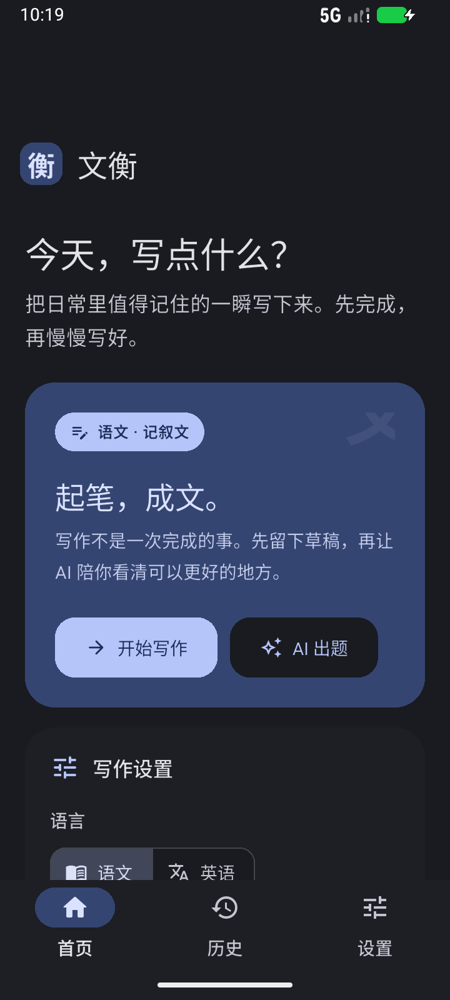 | 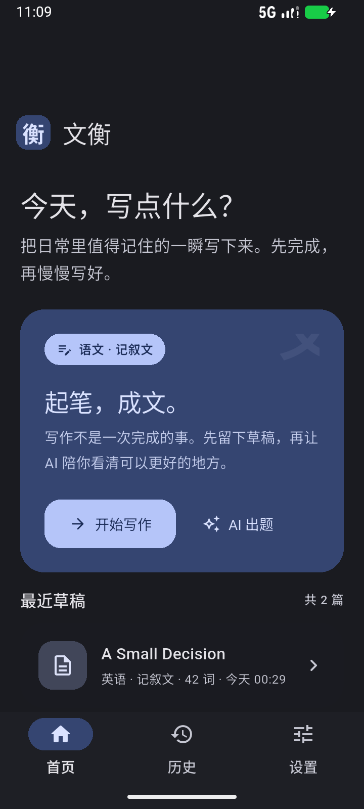 |

| 1.3× 改前 | 1.3× 改后 |
|---|---|
| 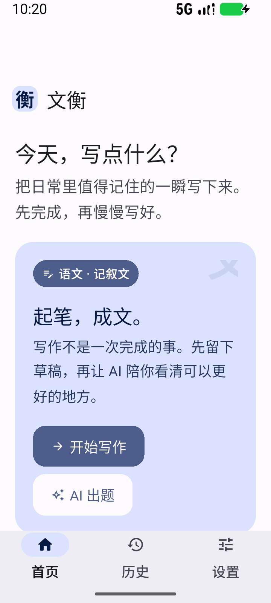 | 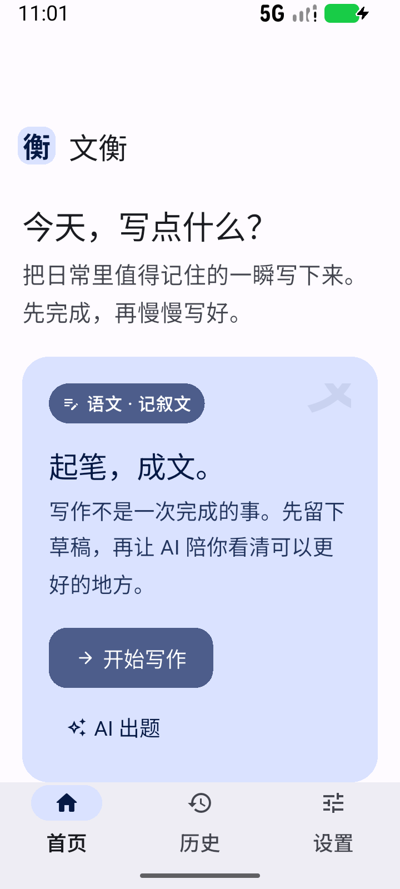 |

1.3× 下 Hero 仍然较高，最近草稿需要下滑约一屏才能看到；这是本轮的已知残留，不是溢出。

### 后续修复：Hero 右上角“文”大 watermark

- 现象：水印只露出下半部分，裁切线是内容盒的直边，不是卡片的圆角。
- 根因：水印放在 `AppSurface` padding 内的 `Stack` 里，`Stack` 默认 `clipBehavior: Clip.hardEdge`，按内容盒裁切；负偏移让字符在内容盒顶部/右侧被切断。
- 改动：`lib/features/home/home_page.dart:323-400` 将 Hero 改为卡片级 `Container(clipBehavior: Clip.antiAlias, borderRadius: 24)` + 无 padding 的 `Stack`；水印保持原 `displayLarge` 字号和原位置（换算到卡片坐标是 `right: 8, top: -8`）；正文放进 `Padding(24)`。水印溢出卡片边缘时由卡片圆角裁切，而不是被内层内容盒直切。
- 原则：L4、L7（装饰元素应服从卡片轮廓，而不是出现意外的直切边）。

| 改前（内容盒直切） | 改后（卡片圆角裁切的大水印） |
|---|---|
| 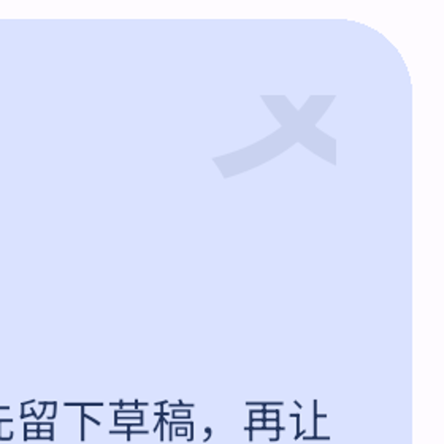 | 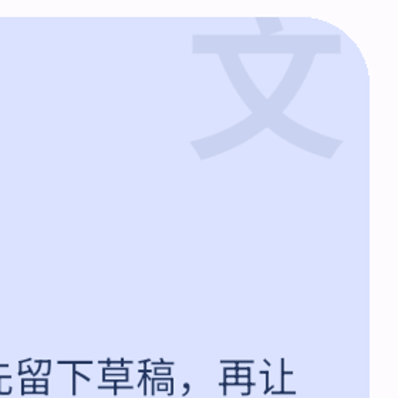 |

完整页面：

| 改前 | 改后 |
|---|---|
| 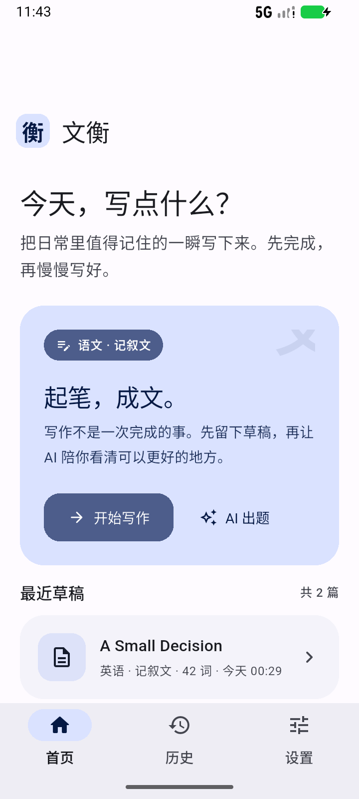 |  |

---

## 4. 设置页

- 违反原则：L4、L6。
- 改动：“保存密钥”改为 filled primary 并放前；“测试连接”改为 outlined secondary；“移除”保持 text。
- 位置：`lib/features/settings/settings_page.dart:490-504`。

| 改前：测试连接最重 | 改后：保存密钥最重 |
|---|---|
| 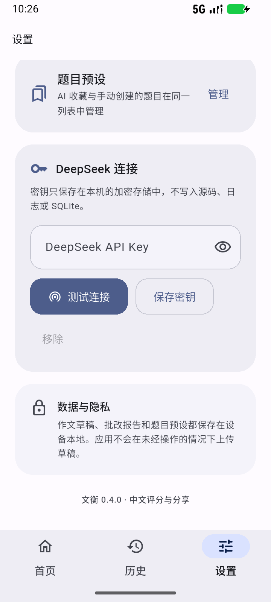 | 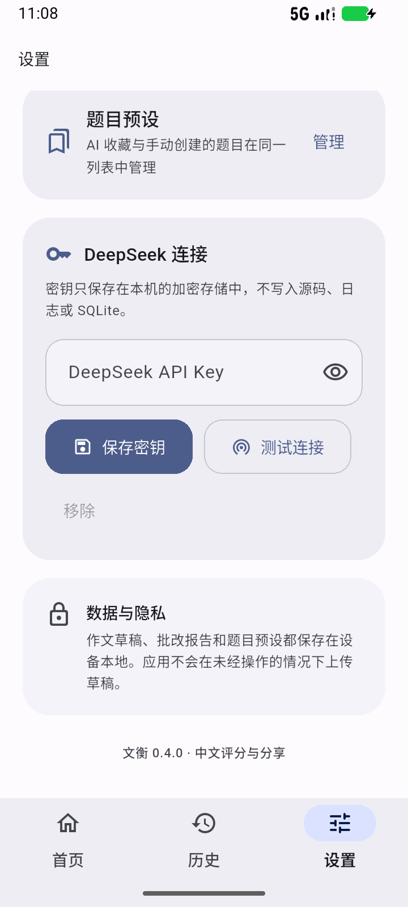 |

---

## 5. 文件 diff 摘要

### 源码

- `lib/features/editor/editor_page.dart`
  - `build`：新增 `keyboardInset`；底部栏包 `AnimatedPadding`；`_EditorBottomBar` 新增 `compact`。
  - `_EditorBottomBar.build`：IME 打开时渲染紧凑行（字数 + 保存 + 提交），关闭时保留完整进度/状态/双按钮。
  - `_PromptReference`：padding、间距、`maxHeight` 调整。
  - 状态行：`StatusPill` → `Text`。
- `lib/features/prompt_generation/prompt_generation_sheet.dart`
  - `build`：`AnimatedPadding` + `viewInsets`。
  - `_buildSetup`：由单一 `ListView` 改为 `Expanded(ListView)` + `_SetupFooter`。
  - 新增 `_SetupFooter`：提示输入框 + 生成按钮。
  - 错误阶段移除重复的 `viewInsets` padding。
- `lib/features/home/home_page.dart`
  - 内容顺序调整；Hero AI 按钮类型调整；`_BriefCard`/`_ApiKeyNotice` padding 与间距压缩。
  - Hero 改为卡片级 `Clip.antiAlias` + `borderRadius: 24`；水印保持原字号和原位置（卡片坐标 `right:8, top:-8`），由卡片圆角裁切。
- `lib/features/settings/settings_page.dart`
  - API Key 操作组顺序与视觉权重调整。

### 测试

- 新增 `test/features/editor_layout_test.dart`（4 项）：
  - 键盘下提交按钮在键盘上方；
  - 1.3× + 键盘不溢出；
  - 作文题预览 ≤ 150px；
  - “AI 批改”不再是 `StatusPill`。
- 新增 `test/features/prompt_sheet_layout_test.dart`（1 项）：
  - `viewInsets.bottom = 300` 时，提示输入框与生成按钮仍可见且在键盘上方。
- 新增 `test/features/home_layout_test.dart`（2 项）：
  - 最近草稿位于写作设置之前；AI 出题是 `TextButton` 而非 `FilledButton`；
  - Hero 水印保持原偏移（`top = stack.top - 8`、`right = stack.right - 8`），并由卡片圆角裁切（`Container.clipBehavior = Clip.antiAlias`、圆角 24）。
- `test/settings/settings_page_test.dart` 新增 1 项：
  - 保存密钥是 `FilledButton`，测试连接是 `OutlinedButton`。

### 文档/截图

- `docs/screenshots/ui-audit/`：新增本轮改前/改后截图。
- `docs/ui-layout-report.md`：本报告。

未改：`AppTheme`、`AppSemanticColors`、`app_widgets.dart`、路由、数据库、AI 服务、任何页面文件结构。

---

## 6. 验证

在最终源码上运行：

- `flutter test --no-pub` → **68 项全部通过**。
  - 宿主机缺少 `libsqlite3.so` 开发符号链接，测试时用 `.tooling/lib/libsqlite3.so → /lib64/libsqlite3.so.0`；这是环境修复，不改仓库代码。
- `flutter analyze` → **No issues found**。
- `flutter build apk --release --target-platform android-x64 --no-pub` → 构建成功。
- 在 API 36.1 模拟器安装 release APK，采集了浅色、深色、1.3×、编辑页键盘、出题面板键盘、设置页等改后截图。

### 未取到的运行截图

**1.3× + 键盘同时出现**：模拟器 Gboard 在大字号重启后出现 `inputShown=true` 但 `screencap` 未合成 IME 层的情况；改用 widget test 在 360×800、`viewInsets.bottom=300`、1.3× 下验证：提交按钮底边 ≤ 500，且 `tester.takeException()` 为空。1.0× 键盘截图与 1.3× 无键盘截图分别见上。

---

## 7. 已知问题，本轮不处理

- **P1-4 空状态 CTA**：历史为空仍只有说明；首页空草稿、预设空列表也只有文字。需要确认是否允许在空状态复用现有入口。
- **P1-7 批改错误重试**：错误/重试按钮仍在 `ListView` 中部；无 API Key，未采集真实运行状态，未改。
- **P2-1 全站 16dp/间距网格**：页面仍是 20dp，卡片内边距与 6/10/14/18/22/26/28 等目测值仍在。
- **P2-2 重复标题**：设置/历史/预设仍有 AppBar 标题 + 页面大标题。
- **P2-3 报告反馈容器不一致**：逐句 `Card+ExpansionTile` vs 逐段 `AppSurface`，间距 8/10。
- **P2-4 加载态跳动**：仍是居中 spinner，未加骨架/固定高度。
- **P2-5/2-6/2-7**：列表删除/刷新交互、报告分享/复制 8dp 间距、预设卡片密度，均未动。
- **P1-1 残留**：1.3× 下首屏仍看不到最近草稿（需下滑约一屏）；1.0× 已进入首屏。若要彻底解决，需要在 Hero 内加“继续最近草稿”入口，属于新增交互，留待确认。
- **P1-3 取舍**：采用 132 → 72dp 的保守方案，没有新增展开交互；完整题目仍需在卡内滚动。
